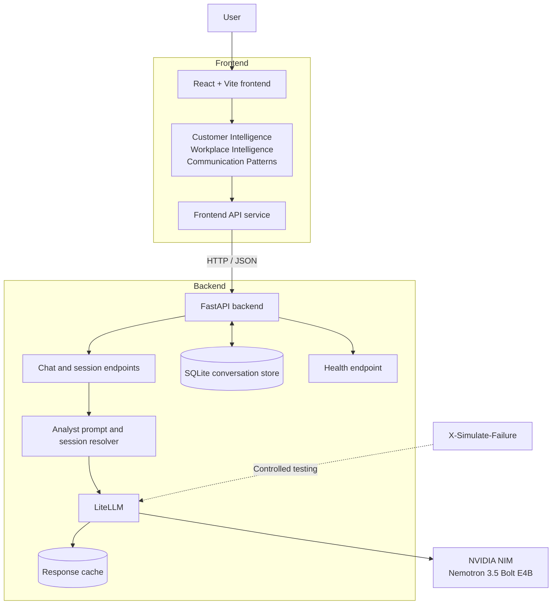

# Conversational Intelligence Studio

**Understand the conversations behind your business.**

Conversational Intelligence Studio (CIS) is a multi-analyst conversational intelligence application that helps users extract useful insights from customer and workplace conversations. It turns conversation transcripts into structured findings about intent, recurring concerns, unresolved follow-ups, operational blockers and communication dynamics.

## Live Application

- **Frontend:** [https://conversational-intelligence-studio.vercel.app](https://conversational-intelligence-studio.vercel.app)
- **Backend API:** [https://conversational-intelligence-studio.onrender.com](https://conversational-intelligence-studio.onrender.com)
- **Health check:** [https://conversational-intelligence-studio.onrender.com/health](https://conversational-intelligence-studio.onrender.com/health)

The frontend is deployed on Vercel and the FastAPI backend is deployed on Render. The backend health endpoint reports service status, configured key count and cache status.

## Analyst Workspaces

CIS provides three specialised analytical perspectives in one application:

### Customer Intelligence
Analyses customer-facing conversations to identify customer intent, recurring complaints, service friction, unresolved queries and follow-up opportunities.

### Workplace Intelligence
Examines internal team conversations to surface blockers, unanswered questions, recurring issues and topics that may need human attention.

### Communication Patterns
Explores group communication dynamics, including who raises topics, who responds, how information is handed off and where conversations tend to stall.

Each workspace uses its own analyst instructions and conversation context while sharing the same backend and configured inference model. These are distinct analytical modes, not separately trained models.

## Key Features

- **Three analyst workspaces:** Customer Intelligence, Workplace Intelligence and Communication Patterns.
- **Conversational analysis:** Submit a transcript and ask contextual questions or follow-ups.
- **Session management:** Create and revisit separate conversations.
- **Persistent conversation history:** Store and retrieve session messages using SQLite.
- **Structured analysis:** Generate findings grounded in the supplied conversation.
- **Response metadata:** Inspect inference source, model, latency, token usage, key identifier and fallback attempts.
- **Response caching:** Cache eligible responses to reduce repeated inference calls.
- **Provider integration through LiteLLM:** Use a unified interface to the configured inference provider.
- **API-key retry/failover logic:** The backend supports an ordered key pool and fallback attempts. The current hosted deployment is configured with one NVIDIA API key, so multi-key failover is not demonstrated by the live deployment.
- **Controlled failure simulation:** Exercise failure and retry behaviour during testing.
- **Interface preferences and accessibility:** Includes theme and presentation preferences.

## Technology Stack

| Layer | Technology |
|---|---|
| Frontend | React, JavaScript |
| Build tooling | Vite |
| Backend | Python, FastAPI, Pydantic |
| LLM integration | LiteLLM |
| Hosted inference | NVIDIA NIM — `nvidia/nemotron-3.5-bolt-e4b` |
| Database | SQLite |
| Response cache | LiteLLM cache |
| Testing | pytest |
| Containerisation | Docker, Docker Compose |
| Frontend hosting | Vercel |
| Backend hosting | Render |

## Architecture

The React frontend provides the analyst workspaces and conversation interface. It sends requests to the FastAPI backend, which resolves the analyst instructions, manages session history, invokes the configured model through LiteLLM, and stores messages and response metadata in SQLite.



### Request Flow

1. The user selects an analyst workspace and submits a transcript or question.
2. The frontend sends the message, session identifier and analyst type to the FastAPI backend.
3. The backend resolves the applicable analyst instructions and retrieves prior messages for the session.
4. LiteLLM checks the response cache where applicable and sends a cache miss to the configured NVIDIA NIM model.
5. The backend stores the response and associated metadata in SQLite.
6. The frontend displays the analysis and its technical metadata. Session history can be retrieved through the messages endpoint.

## API

The backend exposes these endpoints:

| Method | Endpoint | Purpose |
|---|---|---|
| `GET` | `/health` | Reports backend health and configured service status |
| `POST` | `/chat` | Sends a message and receives an assistant response |
| `GET` | `/sessions/{session_id}/messages` | Retrieves messages and response metadata for a session |

Assistant response metadata includes:

- `resolution_source`
- `model`
- `latency_ms`
- `input_tokens`
- `output_tokens`
- `key_id`
- `fallback_attempts`

The live health endpoint can be checked at [`/health`](https://conversational-intelligence-studio.onrender.com/health).

## Project Structure

```text
CIS/
├── cis-frontend/
│   ├── src/
│   │   ├── components/
│   │   ├── data/
│   │   └── services/
│   ├── Dockerfile
│   ├── nginx.conf
│   └── package.json
│
├── cis-backend/
│   ├── app/
│   ├── tests/
│   ├── data/                 # Local runtime data; not committed
│   ├── Dockerfile
│   ├── requirements.txt
│   └── requirements-dev.txt
│
├── docker-compose.yml
├── Makefile
├── DOCKER_SETUP.txt
├── .gitignore
└── README.md
```

## Run Locally

### Prerequisites

- Node.js and npm
- Python 3.11+
- An NVIDIA NIM API key
- Docker Desktop with Docker Compose (for containerised execution)

### Frontend

```bash
cd cis-frontend
npm install
npm run dev
```

### Backend

```bash
cd cis-backend
python -m venv .venv
```

Activate the virtual environment and install dependencies:

```powershell
# Windows PowerShell
.venv\Scripts\Activate.ps1
python -m pip install -r requirements-dev.txt
```

Create `cis-backend/.env` with the provider key and the configuration expected by `app/config.py`. The hosted NVIDIA setup uses the following variable names and model identifier:

```env
NVIDIA_NIM_API_KEY=your_nvidia_nim_api_key
LLM_MODEL=nvidia_nim/nvidia/nemotron-3.5-bolt-e4b
DATABASE_URL=sqlite:///./cis.db
ENABLE_FAILURE_SIMULATION=true
CACHE_ENABLED=true
ALLOWED_ORIGINS=http://localhost:3000
```

Keep `.env` private and never commit API keys or other credentials.

Start the backend:

```bash
python -m uvicorn app.asgi:app --reload --port 8000
```

Run backend tests:

```bash
python -m pytest -v
```

### Docker Compose

From the repository root:

```bash
docker compose up --build
```

To stop the services:

```bash
docker compose down
```

Refer to `DOCKER_SETUP.txt` for project-specific container setup notes. Supply required secrets through the local environment configuration; do not put API keys in the Dockerfile or commit them.

## Deployment Configuration

- The Vercel frontend uses `VITE_API_BASE_URL` to point to the deployed backend API base URL.
- The Render backend uses environment variables for the NVIDIA NIM key, model selection, allowed frontend origin, database and cache settings.
- `ALLOWED_ORIGINS` on the backend must include `https://conversational-intelligence-studio.vercel.app`.
- After changing deployment environment variables, redeploy the relevant service so the new configuration is applied.

Do not expose provider keys through frontend variables. In particular, never prefix a secret API key with `VITE_`.

## Responsible Use

CIS is intended to support human understanding of conversations, not replace human judgement. Analytical outputs should be interpreted in context and checked against the source conversation. The application should not be used to infer sensitive personal attributes, make unsupported claims about individuals, or automate employment, disciplinary or other consequential decisions.

Users should obtain appropriate permission and anonymise personal information before submitting conversation data.

## License

To be determined.
