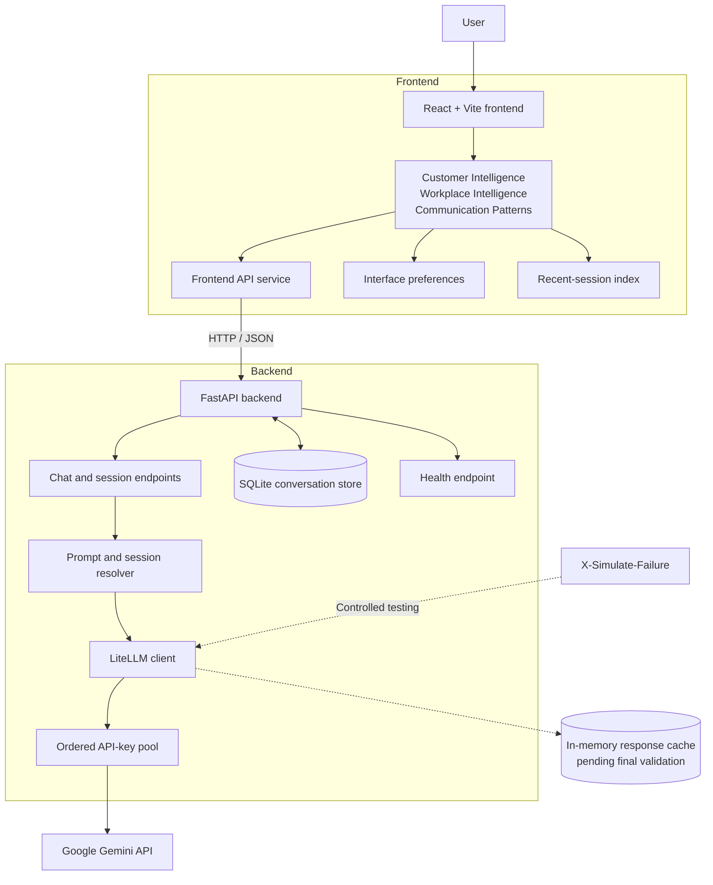

# Conversational Intelligence Studio

**Understand the conversations behind your business.**

Conversational Intelligence Studio (CIS) is a multi-analyst conversational intelligence application designed to help users extract meaningful insights from customer and workplace conversations.

The platform provides specialised analysis modes for examining conversational intent, recurring concerns, unresolved follow-ups, communication patterns and potential operational blockers.

## Overview

CIS brings three specialised analytical perspectives into a unified workspace:

### Customer Intelligence

Analyse customer-facing conversations to identify intent, recurring complaints, service friction, unresolved queries and follow-up opportunities.

### Workplace Intelligence

Examine internal team conversations to surface blockers, unanswered questions, recurring issues and topics that may require human attention.

### Communication Patterns

Explore group communication dynamics, including who raises topics, who responds, how information is handed off and where conversations tend to stall.

Each analyst operates through a dedicated workspace with its own conversation history and analysis context. The analyst modes use distinct instructions while sharing the same backend and model integration.

## Key Features

- **Specialised analyst workspaces:** Three dedicated modes for customer, workplace and communication analysis.
- **Conversational interface:** Submit conversation text and ask contextual follow-up questions.
- **Session management:** Create, revisit and manage separate conversations.
- **Evidence-oriented analysis:** Encourage findings grounded in supplied conversational evidence and direct quotations.
- **Response metadata:** Surface technical information associated with generated responses, including model, latency, token usage and key failover details.
- **Personalisation and accessibility:** Light, dark and system themes, text scaling, contrast and motion preferences.
- **Persistent preferences:** Retain interface and analysis preferences across sessions.
- **Provider failover:** Retry requests with another configured API key when a provider request fails.
- **Controlled failure simulation:** Exercise failover behaviour during testing without depending on an actual provider outage.

## Technology Stack

| Layer | Technology |
|---|---|
| Frontend | React, JavaScript |
| Build tooling | Vite |
| Backend | Python, FastAPI, Pydantic |
| LLM integration | LiteLLM |
| Model provider | Google Gemini API |
| Database | SQLite |
| Testing | pytest |
| Containerisation | Docker, Docker Compose (implementation in progress) |

## Architecture

CIS uses a frontend-backend architecture. The frontend manages the analyst workspaces and user interaction, while the backend resolves prompts, manages conversation sessions, communicates with the configured language model and persists conversation data.



### Request Flow

1. A user selects an analyst workspace and submits a message.
2. The frontend sends the message, session identifier, analyst type and any applicable custom system prompt to the FastAPI backend.
3. The backend resolves the effective system prompt and retrieves the existing conversation history.
4. LiteLLM sends the request to the configured model using the ordered API-key pool. If a key fails, the backend can attempt the next configured key.
5. The assistant response and its execution metadata are stored in SQLite.
6. The frontend displays the response and available metadata. Earlier messages can be retrieved through the session history endpoint.

The response cache is part of the current backend validation work. Its final behaviour and dependency requirements are being checked before it is treated as complete.

## API

The backend exposes the following endpoints:

| Method | Endpoint | Purpose |
|---|---|---|
| `GET` | `/health` | Reports backend availability and configured service status |
| `POST` | `/chat` | Sends a message and receives an assistant response |
| `GET` | `/sessions/{session_id}/messages` | Retrieves messages and response metadata for a session |

Assistant responses include the following execution metadata:

- `resolution_source`
- `model`
- `latency_ms`
- `input_tokens`
- `output_tokens`
- `key_id`
- `fallback_attempts`

## Project Structure

```text
CIS/
│
├── cis-frontend/
│   ├── src/
│   │   ├── components/
│   │   ├── data/
│   │   └── services/
│   ├── package.json
│   └── vite.config.js
│
├── cis-backend/
│   ├── app/
│   ├── tests/
│   ├── data/                 # Local runtime data; not committed
│   ├── requirements.txt
│   └── requirements-dev.txt
│
├── docker-compose.yml        # To be added in the Docker implementation
├── .env.example              # To be added with deployment configuration
├── .gitignore
└── README.md
```

## Current Implementation Status

- [x] React frontend with three analyst workspaces
- [x] Analyst-specific prompt presets
- [x] FastAPI application and required API endpoints
- [x] SQLite conversation and session persistence
- [x] Multi-turn conversation history
- [x] Multiple API-key configuration
- [x] Automatic key failover
- [x] Controlled failure simulation for failover testing
- [x] Response metadata persistence and retrieval
- [ ] Final response-cache validation and acceptance
- [ ] Backend Dockerfile and Docker Compose configuration
- [ ] Public deployment and end-to-end verification

This status reflects the current development checkpoint. Caching, containerisation, deployment and final end-to-end integration remain separate validation tasks.

## Getting Started

### Prerequisites

- Node.js and npm
- Python
- API credentials for a supported language model provider
- Docker and Docker Compose (for the containerised setup, once available)

### Frontend Setup

```bash
cd cis-frontend
npm install
npm run dev
```

### Backend Setup

```bash
cd cis-backend
python -m venv .venv
```

Activate the virtual environment, then install the dependencies:

```bash
python -m pip install -r requirements-dev.txt
```

Create a local `.env` file inside `cis-backend/` and provide the required environment variables and provider API keys. Keep this file local; do not commit it.

Start the backend API:

```bash
python -m uvicorn app.asgi:app --reload --port 8000
```

Run the backend tests:

```bash
python -m pytest -v
```

### Running with Docker

Docker and Docker Compose instructions will be added once the container configuration has been implemented and verified. The intended workflow is:

```bash
docker compose up --build
```

To stop the application:

```bash
docker compose down
```

## Configuration

Application credentials and environment-specific settings are supplied through environment variables.

Use `.env.example` as a reference when configuring a local environment once it is added. Never commit API keys, credentials or private environment files.

Local SQLite databases, virtual environments, caches and generated runtime data should remain outside source control.

## Responsible Use

CIS is intended to support human understanding of conversations, not replace human judgement.

Its analytical outputs should be interpreted in context and verified against the underlying conversation. The platform should not be used to infer sensitive personal attributes, make unsupported claims about individuals, or automate employment, disciplinary or other consequential decisions.

Users should obtain appropriate permission and anonymise personal information before submitting conversation data.

## License

To be determined.
